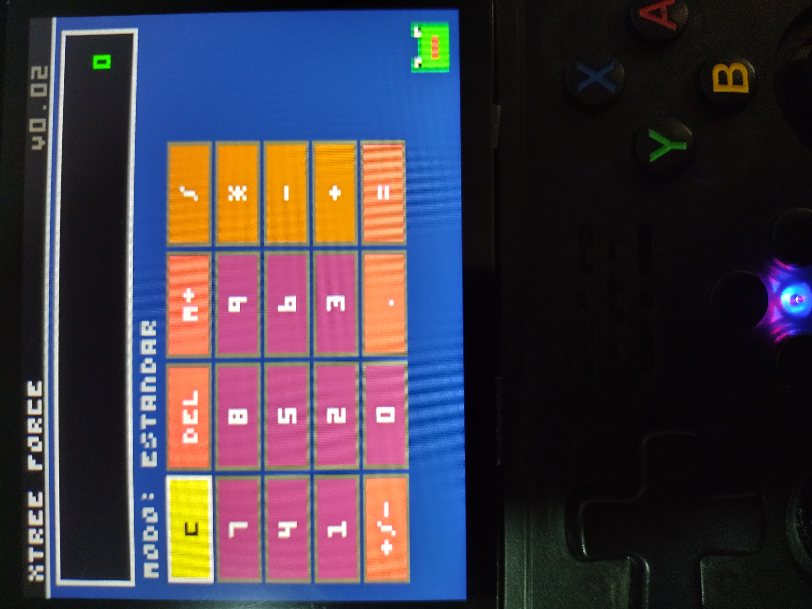
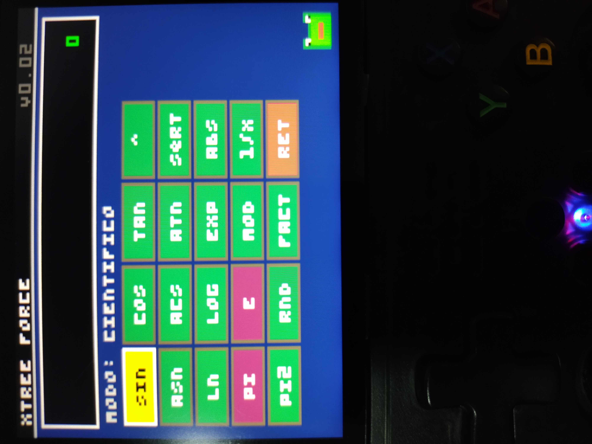
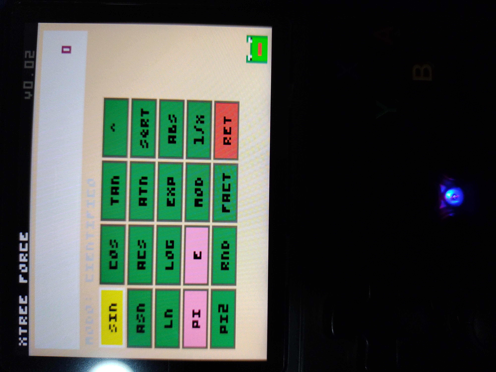

<!-- HEADER SECTION -->

  <h1>🎮 PICO-8 Ecosystem Applications</h1>
  
In this repository, I will be posting the applications I develop specifically for this platform. To ensure these applications work, it is recommended that you have the <code>picante8_libretro.so</code> core installed within your TreeFrogUI system.

<!-- SYSTEM NOTICE (Using blockquote simulation) -->
<blockquote>
  <strong>⚠️ Supported Systems:</strong> This core is actively supported on platforms running emulation frontends and custom frontend such as <strong>SwitchFrogUi</strong> (R36SX and clones), <strong>H.OS</strong>, and compatible PicoArch handheld environments utilizing TreeFrogUI.
</blockquote>

 

 

<!-- FEATURED APPLICATIONS TITLE -->
<h2>🚀 Featured Applications</h2>

<!-- APP CARD START -->

  <!-- APP HEADER -->
  <h3>🧮 Calculator Xtree <kbd>V0.04</kbd></h3>
  
  <!-- APP DESCRIPTION -->
  

    <strong>Calculator Xtree</strong> is a hybrid utility engineered for PICO-8. This initial release features core support for standard basic mathematical functions, seamlessly combined with an advanced scientific mode that can be toggled on demand. It features a fully dynamic rendering engine capable of redrawing the custom user interface instantly to support multiple high-fidelity color presets.
  

  <!-- IMAGE GALLERY WITH VISIBLE SUBTITLES -->
  <h4>📸 Screenshots</h4>
  <table width="100%">
    <tr>
      <td align="center" width="33.3%">
        
         <b>Standard Mode</b>
      </td>
      <td align="center" width="33.3%">
        
         <b>Scientific Mode</b>
      </td>
      <td align="center" width="33.3%">
        
         <b>Cyberpunk Themes</b>
      </td>
    </tr>
  </table>

  <!-- SHORTCUTS SECTION -->
  <h4>⌨️ Additional Functions & Key Shortcuts</h4>
  <ul>
    <li><strong>B + Up Arrow:</strong> Switch between Standard Mode and Advanced Scientific Mode. The on-screen indicator will change automatically. (<code>MODE: STANDARD / MODE: SCIENTIFIC</code>).</li>
    <li><strong>B + Right Arrow:</strong> Switch instantly between 5 high-fidelity Cyberpunk color themes, redrawing the entire interface in a flash.</li>
    <li><strong>B + Left Arrow:</strong> Enable or disable the cinematic "About" screen, which triggers an automatic scroll displaying development details, features, and the app version.</li>
    <li><strong>B + Down Arrow:</strong> Access the history of calculations performed in the calculator (an experimental feature in version 0.04 for now)</li>
    <li><strong>A + Right Arrow:</strong> Perform a Quick Clear All. This clears the main display (0), erases the operation history from the sub-display, and resets internal variables to safely start a calculation from scratch.</li>
  </ul>

   

  <!-- CHANGELOG DROPDOWN (Native HTML Accordion) -->
  

    
<strong>📋 Click to view Version History & Changelog</strong>

     
    <h4>Version 0.04 (current version)</h4>
    <ul>
      <li>A history system for past calculations is now available. You can access it by pressing the 'B' button + the Down directional button.</li>
      <li>This new feature allows you to record your calculations. Please note that the current storage capacity is very limited, which may lead to some compatibility issues (this will be addressed in future updates).</li>
      <li>You can navigate through the history using the Up and Down directional buttons.</li>
      <li>You can also confirm a selection to display it on the calculator screen (though this may occasionally cause errors).</li>
      <li>Based on my testing, this does not cause PICO-8 (using the `picante8_libretro.so` core) to freeze or crash.</li>
      <li>All mathematical, scientific, and other functions in the project are stable; only this new feature is still under development and may present some issues for now.</li>
      <li>The little frog can now display or express emotions as you perform more calculations, starting from its default state (this is still a work in progress).</li>
    </ul>
    <h4>Version 0.03</h4>
    <ul>
      <li>The issue with double-clicks when pressing the numbers for mathematical operations has been resolved, making it more stable this time around.</li>
      <li>If your retro console along with its system features a real or simulated RTC (Real-Time Clock), you will now be able to see the console's current time displayed within the calculator itself.</li>
      <li>Some corrections have been made that will soon allow the scientific LOG option to function.</li>
      <li>A total of 10 themes have been added; you can now select whichever one you like.</li>
      <li>Now the calculator app will remember the last theme you selected, no problem! :)</li>
    </ul>
    <h4>Version 0.02</h4>
    <ul>
      <li>Some issues with certain scientific functions have been resolved.</li>
      <li>An "About" section has been added, indicating who was responsible for developing this software in conjunction with AI.</li>
      <li>Some errors in mathematical operations have been fixed.</li>
      <li>Some details resolved.</li>
    </ul>
    <h4>Version 0.01 (Initial Release)</h4>
    <ul>
      <li>Initial version.</li>
      <li>Support has been added for a calculator that features basic functions, which can be combined with a scientific mode if you wish.</li>
      <li>Support for scientific mode has been added.</li>
      <li>You can change the default colors in this version using the quick-access options.</li>
    </ul>
  

<!-- APP CARD END -->

 

 

  Developed for PICO-8 & Picante8 Ecosystem

