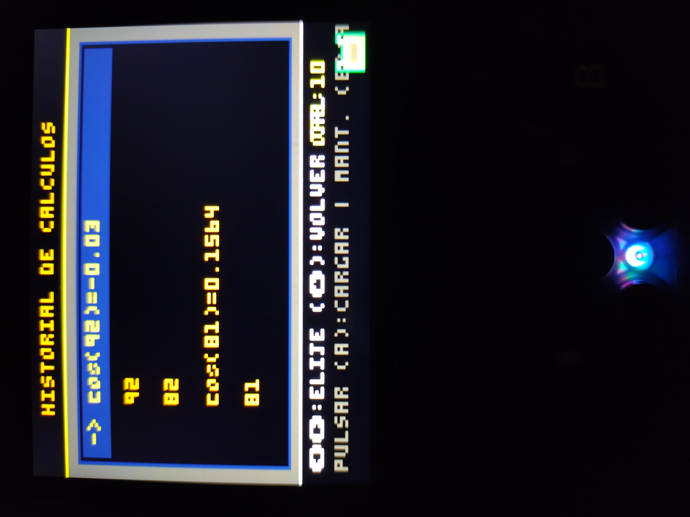
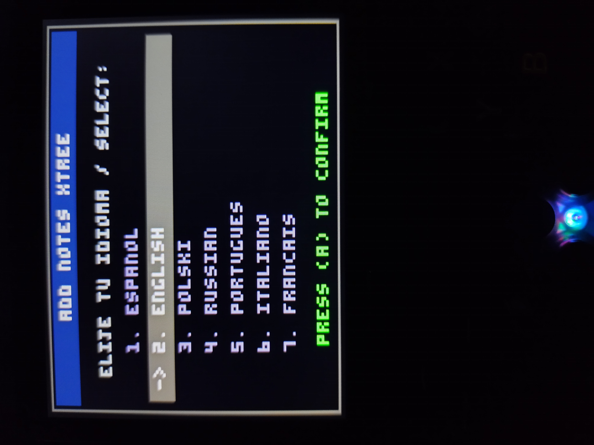
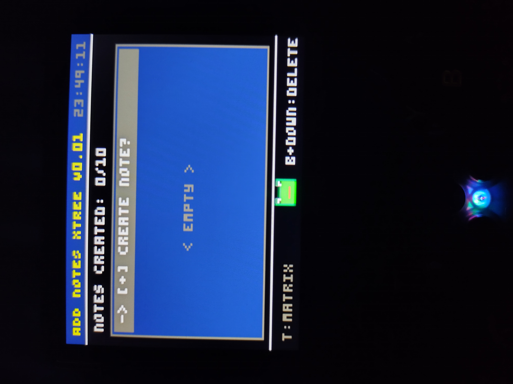
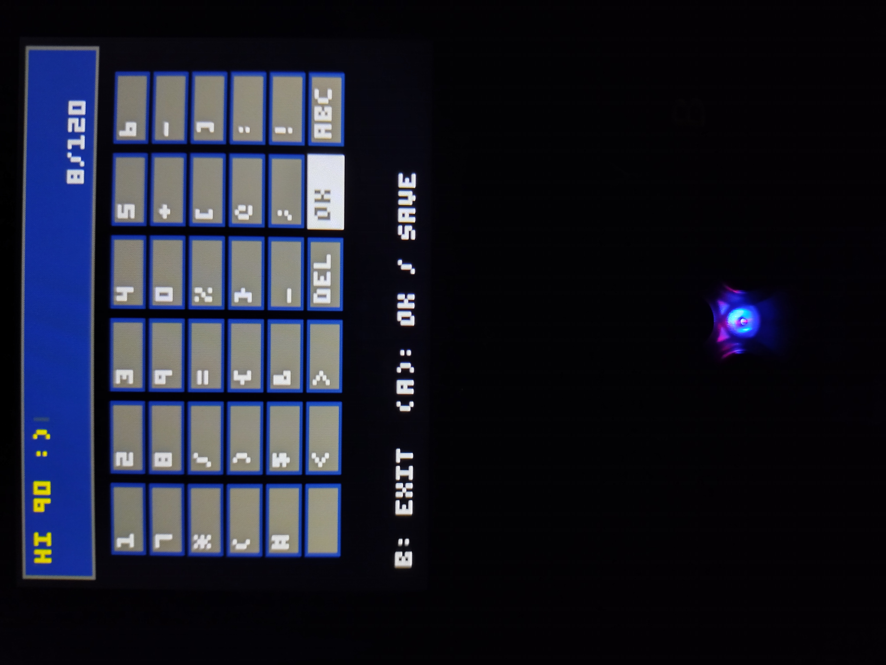
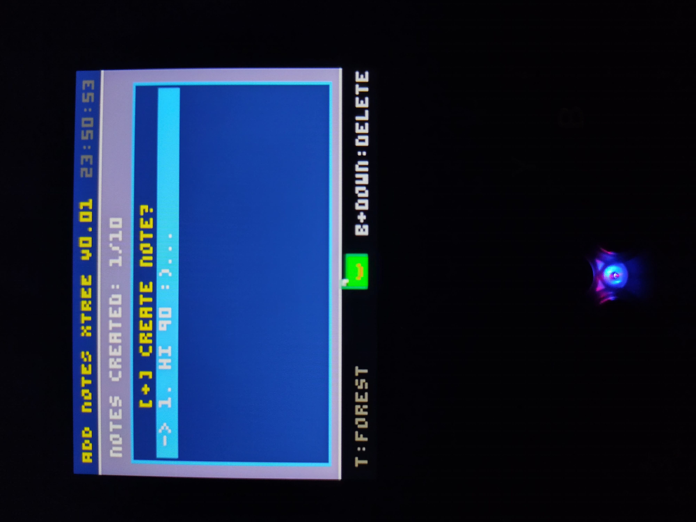

<!-- HEADER SECTION -->

  <h1>🎮 PICO-8 Ecosystem Applications</h1>
  
In this repository, I will be posting the applications I develop specifically for this platform. To ensure these applications work, it is recommended that you have the <code>picante8_libretro.so</code> core installed within your TreeFrogUI system.

<!-- SYSTEM NOTICE (Using blockquote simulation) -->
<blockquote>
  <strong>⚠️ Supported Systems:</strong> This core is actively supported on platforms running emulation frontends and custom frontend such as <strong>SwitchFrogUi</strong> (R36SX and clones), <strong>H.OS</strong>, and compatible PicoArch handheld environments utilizing TreeFrogUI.
</blockquote>

 

 

<!-- FEATURED APPLICATIONS TITLE -->
<h2>🚀 Featured Applications</h2>

<!-- APP CARD START -->

  <!-- APP HEADER -->
  <h3>🧮 Calculator Xtree <kbd>V0.09</kbd></h3>
  
  <!-- APP DESCRIPTION -->
  

    <strong>Calculator Xtree</strong> is a hybrid utility engineered for PICO-8. This initial release features core support for standard basic mathematical functions, seamlessly combined with an advanced scientific mode that can be toggled on demand. It features a fully dynamic rendering engine capable of redrawing the custom user interface instantly to support multiple high-fidelity color presets.
  

  <!-- IMAGE GALLERY WITH VISIBLE SUBTITLES -->
  <h4>📸 Screenshots</h4>
<table width="100%">
  <tr>
    <td align="center" width="33.3%">
      
       <b>Standard Mode</b>
    </td>
    <td align="center" width="33.3%">
      
       <b>Scientific Mode</b>
    </td>
    <td align="center" width="33.3%">
      
       <b>Cyberpunk Themes</b>
    </td>
  </tr>
  <tr>
    <td width="33.3%"></td>
    <td align="center" width="33.3%">
      
       <b>Calculation History</b>
    </td>
    <td width="33.3%"></td>
  </tr>
</table>

  <!-- SHORTCUTS SECTION -->
  <h4>⌨️ Additional Functions & Key Shortcuts</h4>
  <ul>
    <li><strong>B + Up Arrow:</strong> Switch between Standard Mode and Advanced Scientific Mode. The on-screen indicator will change automatically. (<code>MODE: STANDARD / MODE: SCIENTIFIC</code>).</li>
    <li><strong>B + Right Arrow:</strong> Switch instantly between 5 high-fidelity Cyberpunk color themes, redrawing the entire interface in a flash.</li>
    <li><strong>B + Left Arrow:</strong> Enable or disable the cinematic "About" screen, which triggers an automatic scroll displaying development details, features, and the app version.</li>
    <li><strong>B + Down Arrow:</strong> To clear the history, use the B button + the up arrow; navigate through the history using the up and down arrows; confirm the loading of a history entry with the A button; and exit the history using the right arrow.</li>
    <li><strong>A + Right Arrow:</strong> Perform a Quick Clear All. This clears the main display (0), erases the operation history from the sub-display, and resets internal variables to safely start a calculation from scratch.</li>
  </ul>

<!-- APP CARD START: ADD NOTES XTREE -->

  <!-- APP HEADER -->
  <h3>📝 Add Notes Xtree <kbd>V0.01</kbd></h3>
  
  <!-- APP DESCRIPTION -->
  

    <strong>Add Notes Xtree</strong> is a versatile note-taking utility engineered for PICO-8. This stable initial release allows you to save and manage quick notes directly on your retro handheld console running the <code>picante8_libretro.so</code> core. It features custom save-state retention, a built-in multilingual system, and an adaptive user interface tailored for retro environments.
  

  <!-- IMAGE GALLERY WITH VISIBLE SUBTITLES -->
  <h4>📸 Screenshots</h4>
  <table width="100%">
    <tr>
      <td align="center" width="33.3%">
        
         <b>Language Selection</b>
      </td>
      <td align="center" width="33.3%">
        
         <b>Main Interface</b>
      </td>
      <td align="center" width="33.3%">
        
         <b>Virtual Keyboard</b>
      </td>
    </tr>
    <tr>
      <td width="33.3%"></td>
      <td align="center" width="33.3%">
        
         <b>Selected Theme</b>
      </td>
      <td width="33.3%"></td>
    </tr>
  </table>

  <!-- KEY FEATURES SECTION -->
  <h4>🌟 Core Features</h4>
  <ul>
    <li><strong>Note Management:</strong> Save up to 10 active notes simultaneously. Each note supports a maximum length of 120 characters due to system storage limitations (expandable in future updates).</li>
    <li><strong>Native Multi-Language Support:</strong> The first PICO-8 utility to support multiple languages natively. Select your preferred language during the initial setup.</li>
    <li><strong>Persistent Configuration:</strong> Language choices, interface settings, and your personal notes are saved automatically to memory and reloaded instantly upon booting the app.</li>
    <li><strong>Interactive Mascot:</strong> The companion little frog reacts dynamically to your actions, expressing a variety of unique visual emotions as you use the application.</li>
    <li><strong>RTC Clock Support:</strong> Seamless integration with the hardware Real-Time Clock (RTC) or software-simulated clock of your handheld console, displaying the time directly on the screen.</li>
    <li><strong>Full Virtual Keyboard:</strong> Features an optimized, comprehensive digital keyboard containing letters, numbers, and special symbols, complete with custom spacing, trim, and deletion controls.</li>
    <li><strong>Adaptive Themes:</strong> Instant customization with predefined color presets that redraw the entire interface automatically while supporting continuous auto-saving.</li>
  </ul>

  <!-- SHORTCUTS SECTION -->
  <h4>⌨️ Additional Functions & Key Shortcuts</h4>
  <ul>
    <li><strong>A Button:</strong> Open the text input, create new notes, and confirm selections inside the virtual keyboard.</li>
    <li><strong>B + Down Arrow:</strong> Instantly wipe and delete the currently selected note from your storage vault. There is no usage limit on clearing records! :)</li>
    <li><strong>B + Left Arrow:</strong> Triggers the cinematic "About" screen to display development details, technical credits, and AI collaboration insights.</li>
    <li><strong>B + Right Arrow:</strong> Quickly cycles through the preset aesthetic color themes, saving your preference automatically on the fly.</li>
  </ul>

<!-- APP CARD END: ADD NOTES XTREE -->

   

  <!-- CHANGELOG DROPDOWN (Native HTML Accordion) -->
  

    
<strong>📋 Click to view Version History & Changelog</strong>

     
    <h4>Version 0.10 (Calculator Xtree V0.09) - current version</h4>
    <ul>
      <li>A troublesome issue regarding the saving of data in the calculator's history has been resolved.</li>
      <li>Some minor bugs have been fixed.</li>
    </ul>
    <h4>Version 0.09 (Calculator Xtree V0.08)</h4>
    <ul>
      <li>Some improvements have been made.</li>
      <li>A minigame has been added: upon reaching 400 historical records, the little frog will invite you to play it’s up to you whether or not to join in.</li>
      <li>The calculator application has been further stabilized.</li>
    </ul>
    <h4>Version 0.08 (Initial Stable Release 📝 Add Notes Xtree V0.01)</h4>
    <ul>
      <li>Launched the very first stable build of Add Notes Xtree!</li>
      <li>Implemented an automated configuration architecture that memorizes language configurations and notes on startup.</li>
      <li>Integrated full alphanumeric virtual keyboard with symbol sets and text editing controls.</li>
      <li>Added adaptive multi-language framework and dynamic color themes.</li>
      <li>Enabled real and simulated RTC clock tracking alongside emotional expressions for the mascot frog.</li>
    </ul>
    <h4>Version 0.07</h4>
    <ul>
      <li>Fixed some minor issues in the calculator.</li>
      <li>The little frog will blow you occasional kisses while you use the calculator.</li>
      <li>Added more emotions for the little frog.</li>
      <li>If you clear your history too frequently, the little frog will get sad the reason being that it thinks you don’t want to keep a record of your calculations (at least, that’s the angle I took, or one way of looking at it).</li>
      <li>Indicator for the name of the selected theme.</li>
    </ul>
    <h4>Version 0.06</h4>
    <ul>
      <li>The history clearing system has been fixed, as has the little frog animation :)</li>
      <li>An issue with the log entries has been resolved; the history now holds 30 entries before older ones begin to be replaced as new calculations are added.</li>
      <li>Some minor bugs have been fixed</li>
    </ul>
    <h4>Version 0.05</h4>
    <ul>
      <li>The history capacity has been increased to 8 entries, with plans to expand it further. :)</li>
      <li>The number of compatible themes has been increased to 17.</li>
      <li>Several bugs from the previous version have been fixed, including: History clearing: You can now reset the calculator's records (while in the "CALCULATION HISTORY" section, press the B button + Up arrow), Loading results: Confirm a history entry to load its result using the A button, Navigation: Use the Right arrow to exit the history, and the Up/Down arrows to move through the entries.</li>
      <li>Various visual glitches have been corrected.</li>
      <li>Work is still underway to resolve remaining issues in the scientific mode (specifically regarding the LOG function).</li>
    </ul>
    <h4>Version 0.04</h4>
    <ul>
      <li>A history system for past calculations is now available. You can access it by pressing the 'B' button + the Down directional button.</li>
      <li>This new feature allows you to record your calculations. Please note that the current storage capacity is very limited, which may lead to some compatibility issues (this will be addressed in future updates).</li>
      <li>You can navigate through the history using the Up and Down directional buttons.</li>
      <li>You can also confirm a selection to display it on the calculator screen (though this may occasionally cause errors).</li>
      <li>Based on my testing, this does not cause PICO-8 (using the `picante8_libretro.so` core) to freeze or crash.</li>
      <li>All mathematical, scientific, and other functions in the project are stable; only this new feature is still under development and may present some issues for now.</li>
      <li>The little frog can now display or express emotions as you perform more calculations, starting from its default state (this is still a work in progress).</li>
    </ul>
    <h4>Version 0.03</h4>
    <ul>
      <li>The issue with double-clicks when pressing the numbers for mathematical operations has been resolved, making it more stable this time around.</li>
      <li>If your retro console along with its system features a real or simulated RTC (Real-Time Clock), you will now be able to see the console's current time displayed within the calculator itself.</li>
      <li>Some corrections have been made that will soon allow the scientific LOG option to function.</li>
      <li>A total of 10 themes have been added; you can now select whichever one you like.</li>
      <li>Now the calculator app will remember the last theme you selected, no problem! :)</li>
    </ul>
    <h4>Version 0.02</h4>
    <ul>
      <li>Some issues with certain scientific functions have been resolved.</li>
      <li>An "About" section has been added, indicating who was responsible for developing this software in conjunction with AI.</li>
      <li>Some errors in mathematical operations have been fixed.</li>
      <li>Some details resolved.</li>
    </ul>
    <h4>Version 0.01 (Initial Release)</h4>
    <ul>
      <li>Initial version.</li>
      <li>Support has been added for a calculator that features basic functions, which can be combined with a scientific mode if you wish.</li>
      <li>Support for scientific mode has been added.</li>
      <li>You can change the default colors in this version using the quick-access options.</li>
    </ul>
  

<!-- APP CARD END -->

 

 

  Developed for PICO-8 & Picante8 Ecosystem

