<!-- HEADER SECTION -->

  <h1>🎮 PICO-8 Ecosystem Applications</h1>
  
In this repository, I will be posting the applications I develop specifically for this platform. To ensure these applications work, it is recommended that you have the <code>picante8_libretro.so</code> core installed within your TreeFrogUI system.

<!-- SYSTEM NOTICE (Using blockquote simulation) -->
<blockquote>
  <strong>⚠️ Supported Systems:</strong> This core is actively supported on platforms running emulation frontends and custom frontend such as <strong>SwitchFrogUi</strong> (R36SX and clones), <strong>H.OS</strong>, and compatible PicoArch handheld environments utilizing TreeFrogUI.
</blockquote>

 

 

<!-- FEATURED APPLICATIONS TITLE -->
<h2>🚀 Featured Applications</h2>

<!-- APP CARD START -->

  <!-- APP HEADER -->
  <h3>🧮 Calculator Xtree <kbd>V0.11</kbd></h3>
  
  <!-- APP DESCRIPTION -->
  

    <strong>Calculator Xtree</strong> is a hybrid utility engineered for PICO-8. This initial release features core support for standard basic mathematical functions, seamlessly combined with an advanced scientific mode that can be toggled on demand. It features a fully dynamic rendering engine capable of redrawing the custom user interface instantly to support multiple high-fidelity color presets.
  

  <!-- IMAGE GALLERY WITH VISIBLE SUBTITLES -->
  <h4>📸 Screenshots</h4>
<table width="100%">
  <tr>
    <td align="center" width="33.3%">
      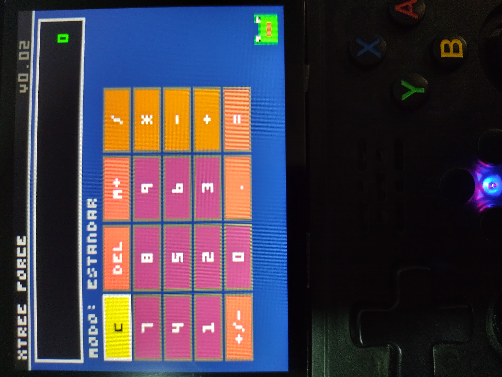
       <b>Standard Mode</b>
    </td>
    <td align="center" width="33.3%">
      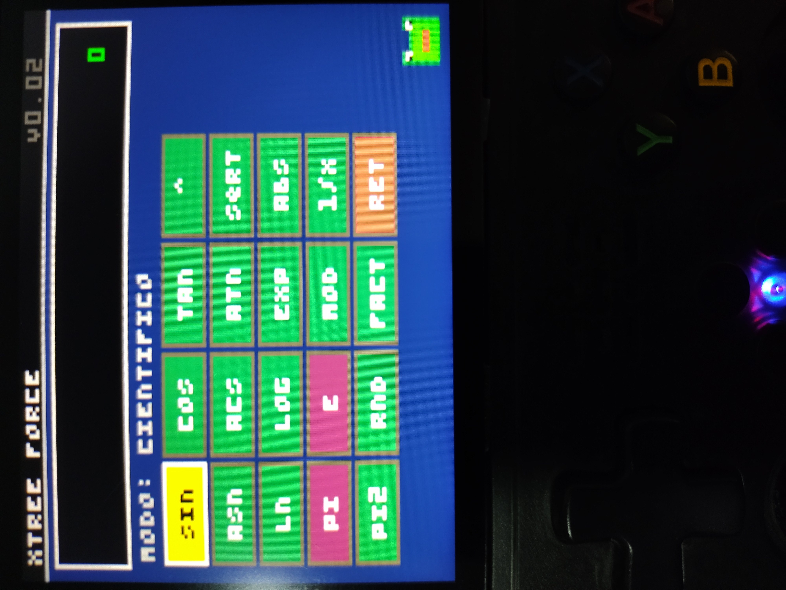
       <b>Scientific Mode</b>
    </td>
    <td align="center" width="33.3%">
      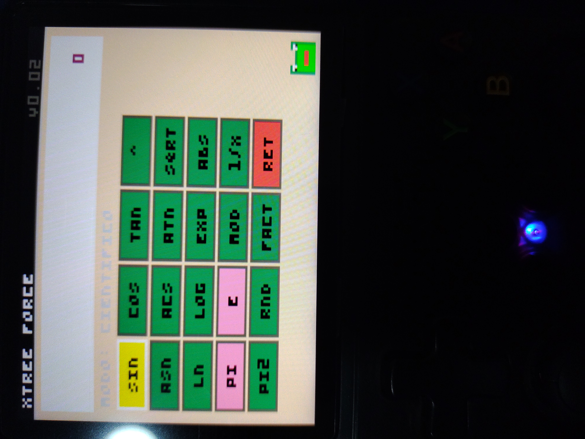
       <b>Cyberpunk Themes</b>
    </td>
  </tr>
  <tr>
    <td width="33.3%"></td>
    <td align="center" width="33.3%">
      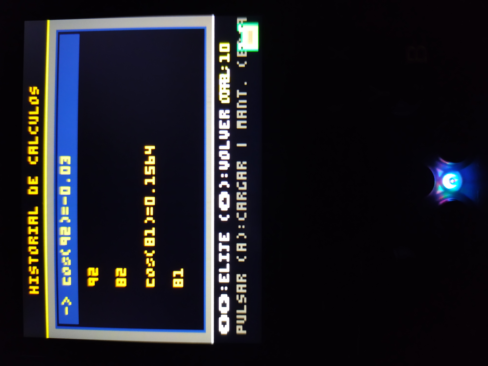
       <b>Calculation History</b>
    </td>
    <td width="33.3%"></td>
  </tr>
</table>

  <!-- SHORTCUTS SECTION -->
  <h4>⌨️ Additional Functions & Key Shortcuts</h4>
  <ul>
    <li><strong>B + Up Arrow:</strong> Switch between Standard Mode and Advanced Scientific Mode. The on-screen indicator will change automatically. (<code>MODE: STANDARD / MODE: SCIENTIFIC</code>).</li>
    <li><strong>B + Right Arrow:</strong> Switch instantly between 5 high-fidelity Cyberpunk color themes, redrawing the entire interface in a flash.</li>
    <li><strong>B + Left Arrow:</strong> Enable or disable the cinematic "About" screen, which triggers an automatic scroll displaying development details, features, and the app version.</li>
    <li><strong>B + Down Arrow:</strong> To clear the history, use the B button + the up arrow; navigate through the history using the up and down arrows; confirm the loading of a history entry with the A button; and exit the history using the right arrow.</li>
    <li><strong>A + Right Arrow:</strong> Perform a Quick Clear All. This clears the main display (0), erases the operation history from the sub-display, and resets internal variables to safely start a calculation from scratch.</li>
  </ul>

<!-- APP CARD START: ADD NOTES XTREE -->

  <!-- APP HEADER -->
  <h3>📝 Add Notes Xtree <kbd>V0.07</kbd></h3>
  
  <!-- APP DESCRIPTION -->
  

    <strong>Add Notes Xtree</strong> is a versatile note-taking utility engineered for PICO-8. This stable initial release allows you to save and manage quick notes directly on your retro handheld console running the <code>picante8_libretro.so</code> core. It features custom save-state retention, a built-in multilingual system, and an adaptive user interface tailored for retro environments.
  

  <!-- IMAGE GALLERY WITH VISIBLE SUBTITLES -->
  <h4>📸 Screenshots</h4>
  <table width="100%">
    <tr>
      <td align="center" width="33.3%">
        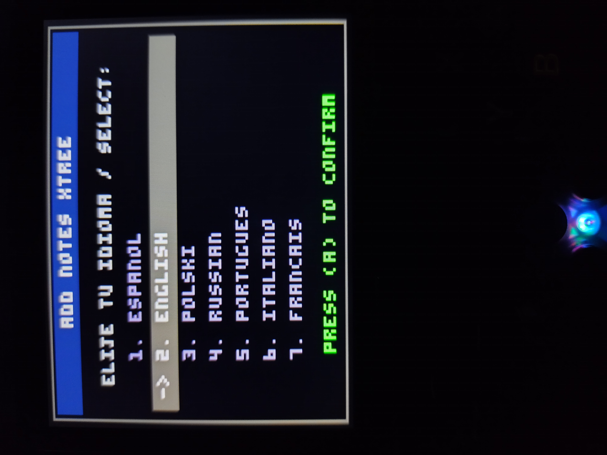
         <b>Language Selection</b>
      </td>
      <td align="center" width="33.3%">
        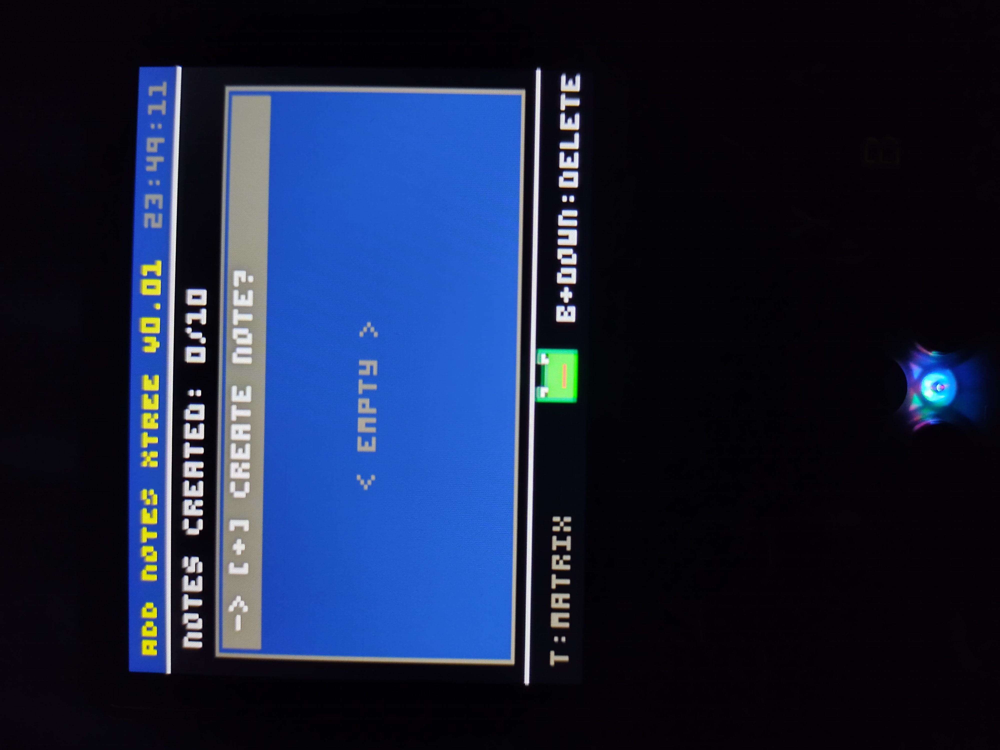
         <b>Main Interface</b>
      </td>
      <td align="center" width="33.3%">
        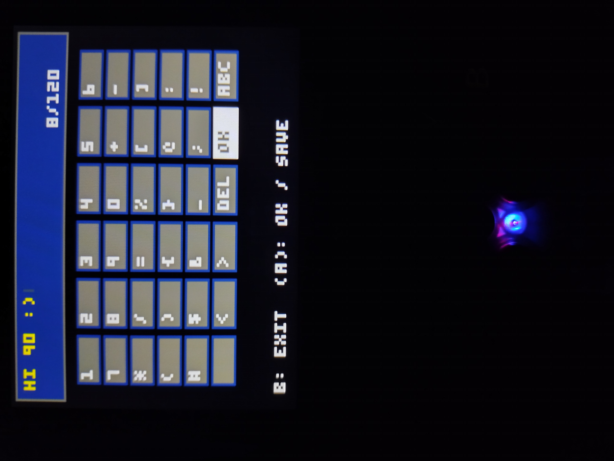
         <b>Virtual Keyboard</b>
      </td>
    </tr>
    <tr>
      <td width="33.3%"></td>
      <td align="center" width="33.3%">
        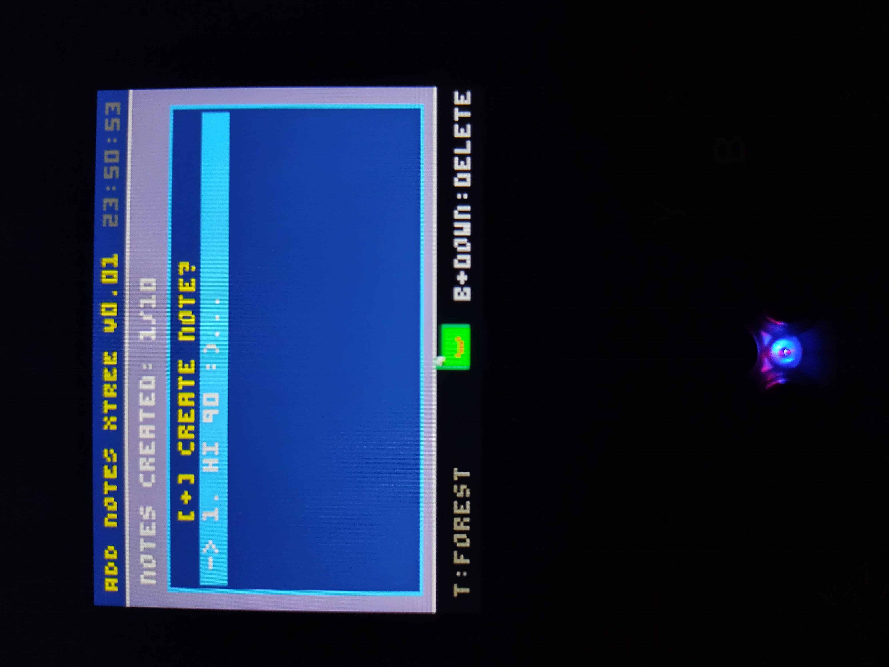
         <b>Selected Theme</b>
      </td>
      <td width="33.3%"></td>
    </tr>
  </table>

  <!-- KEY FEATURES SECTION -->
  <h4>🌟 Core Features</h4>
  <ul>
    <li><strong>Note Management:</strong> Save up to 10 active notes simultaneously. Each note supports a maximum length of 120 characters due to system storage limitations (expandable in future updates).</li>
    <li><strong>Native Multi-Language Support:</strong> The first PICO-8 utility to support multiple languages natively. Select your preferred language during the initial setup.</li>
    <li><strong>Persistent Configuration:</strong> Language choices, interface settings, and your personal notes are saved automatically to memory and reloaded instantly upon booting the app.</li>
    <li><strong>Interactive Mascot:</strong> The companion little frog reacts dynamically to your actions, expressing a variety of unique visual emotions as you use the application.</li>
    <li><strong>RTC Clock Support:</strong> Seamless integration with the hardware Real-Time Clock (RTC) or software-simulated clock of your handheld console, displaying the time directly on the screen.</li>
    <li><strong>Full Virtual Keyboard:</strong> Features an optimized, comprehensive digital keyboard containing letters, numbers, and special symbols, complete with custom spacing, trim, and deletion controls.</li>
    <li><strong>Adaptive Themes:</strong> Instant customization with predefined color presets that redraw the entire interface automatically while supporting continuous auto-saving.</li>
  </ul>

  <!-- SHORTCUTS SECTION -->
  <h4>⌨️ Additional Functions & Key Shortcuts</h4>
  <ul>
    <li><strong>A Button:</strong> Open the text input, create new notes, and confirm selections inside the virtual keyboard.</li>
    <li><strong>B + Down Arrow:</strong> Instantly wipe and delete the currently selected note from your storage vault. There is no usage limit on clearing records! :)</li>
    <li><strong>B + Left Arrow:</strong> Triggers the cinematic "About" screen to display development details, technical credits, and AI collaboration insights.</li>
    <li><strong>B + Right Arrow:</strong> Quickly cycles through the preset aesthetic color themes, saving your preference automatically on the fly.</li>
  </ul>

<!-- APP CARD END: ADD NOTES XTREE -->

  <!-- APP CARD START: COUNTER GAMES XTREE -->

  <!-- APP HEADER -->
  <h3>🏆 Counter Games Xtree <kbd>V0.12</kbd></h3>
  
  <!-- APP DESCRIPTION -->
  

    <strong>Counter Games Xtree</strong> is a comprehensive gaming achievement and progress tracking utility engineered for PICO-8. Built to maximize the utility of retro clone handheld consoles, this system allows you to keep detailed logs and custom counters of your milestones across multiple games. Featuring an upgraded virtual keyboard, 18 native languages, and deep visual customization, it stands as the most complete AI-assisted utility in the collection.
  

  <!-- IMAGE GALLERY WITH VISIBLE SUBTITLES -->
  <h4>📸 Screenshots</h4>
  <table width="100%">
    <tr>
      <td align="center" width="33.3%">
        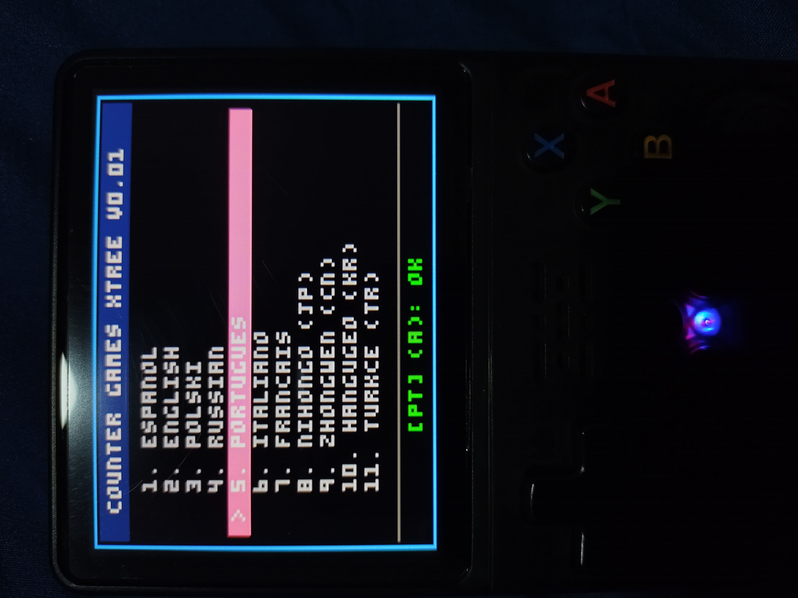
         <b>Initial Setup</b>
      </td>
      <td align="center" width="33.3%">
        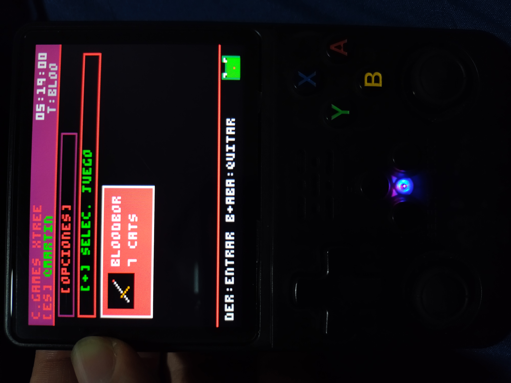
         <b>Main Menu</b>
      </td>
      <td align="center" width="33.3%">
        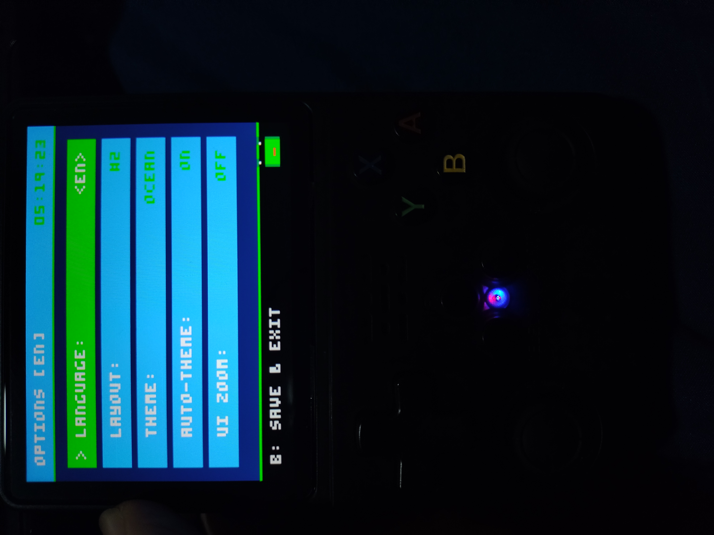
         <b>Configuration System</b>
      </td>
    </tr>
    <tr>
      <td width="33.3%"></td>
      <td align="center" width="33.3%">
        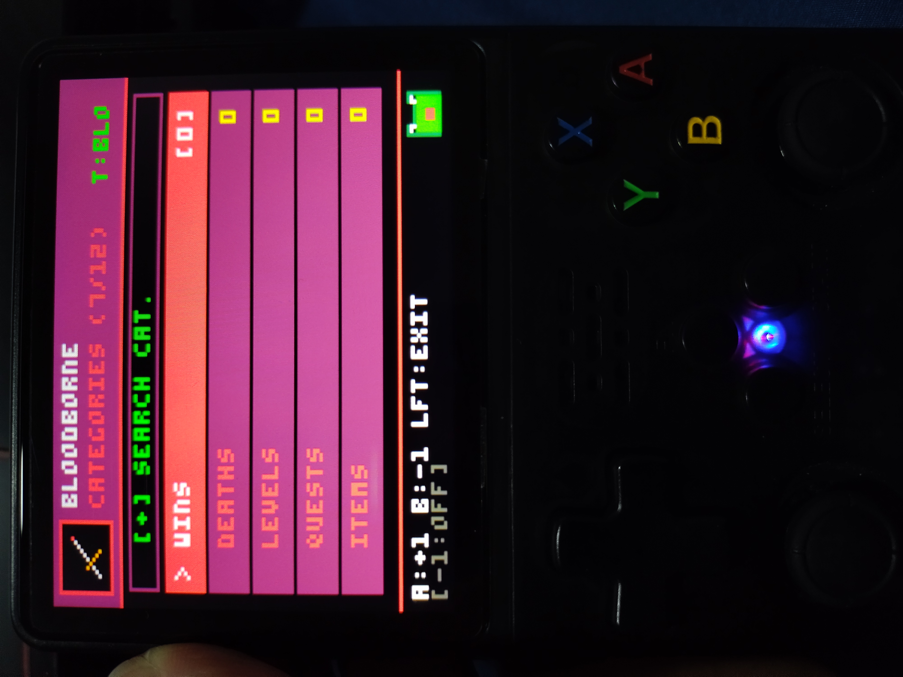
         <b>Demo Game</b>
      </td>
      <td width="33.3%"></td>
    </tr>
  </table>

  <!-- KEY FEATURES SECTION -->
  <h4>🌟 Core Features</h4>
  <ul>
    <li><strong>18-Language Native Support:</strong> Expanded multilingual engine supporting 18 distinct languages out of the box, with instant language switching from the options menu.</li>
    <li><strong>Custom User Profile:</strong> Personalize your experience by entering your player username using a modernized, high-responsiveness virtual keyboard built for PICO-8.</li>
    <li><strong>Game & Objective Tracking:</strong> Create entries for specific games and organize custom achievement categories inside each title, with the flexibility to add more objectives anytime.</li>
    <li><strong>Interactive LED Confirmation System:</strong> Visual LED indicators light up when you complete an objective and confirm it with the action button (fully remappable to your preference).</li>
    <li><strong>Dynamic UI Layouts & Auto-Themes:</strong> Choose between at least 4 distinct interface designs, switch color presets, or activate <strong>Auto-Theme</strong> to automatically adapt the color scheme to the selected game.</li>
    <li><strong>Mini shop:</strong> You can now purchase add-ons for your frog pet, along with various other extras.</li> 
    <li><strong>Comprehensive Options Menu:</strong> Includes <strong>Zoom-UI</strong> for scaling the graphical interface, periodic motivational messages, frog mascot mood selector, button visualizer and remapping, and a full data wipe option.</li>
  </ul>

  <!-- SHORTCUTS SECTION -->
  <h4>⌨️ Controls & Key Shortcuts</h4>
  <ul>
    <li><strong>A Button:</strong> Primary action button in the main menu (add new game) and adds <code>+1</code> to the selected counter inside a game.</li>
    <li><strong>B Button:</strong> Subtracts <code>-1</code> from the currently selected objective counter.</li>
    <li><strong>Right Arrow:</strong> Quickly enters the currently selected or newly created game from the main menu.</li>
    <li><strong>Up / Down Arrows:</strong> Navigate smoothly through games, menu options, and objective indicators.</li>
    <li><strong>B + Left Arrow:</strong> Opens the cinematic "About" screen from the main menu.</li>
  </ul>

<!-- APP CARD END: COUNTER GAMES XTREE -->
   

  <!-- CHANGELOG DROPDOWN (Native HTML Accordion) -->
  

    
<strong>📋 Click to view Version History & Changelog</strong>

     
    <h4>Version 0.29 (Counter Games Xtree V0.12 and Add Notes Xtree V0.07) - current version</h4>
    <ul>
      <li>Counter Games Xtree V0.12: Additional safeguards have been added to ensure that your stored data remains safe and accessible :)</li>
      <li>Some of these newly added features have been stabilized.</li>
      <li>Add Notes Xtree Multilingual V0.07: A critical issue with data saving in the "Storage Plus" function has been resolved.</li>
      <li>A new feature has been added (an experimental section for functions operating at the very limits of what is permitted, designed to push PICO-8 further).</li>
      <li>Several issues encountered during the process have been fixed :)</li>
    </ul>
    <h4>Version 0.28 (Counter Games Xtree V0.11)</h4>
    <ul>
      <li>A mini-shop has been added, allowing you to purchase accessories for the little frog, along with other extras, at the stated costs.</li>
      <li>Themes and effects have been integrated into the new shop.</li>
      <li>A critical memory overflow error related to additional storage has been fixed.</li>
      <li>Due to technical limitations regarding `csdata` file storage, the total number of categories has been capped at 96. You can have up to 4 save slots with 20 categories each (with the "extra" feature enabled), plus a 5th slot with up to 16 categories.</li>
      <li>All 4 save slots, in their standard configuration of 12 categories each, are functioning properly.</li>
      <li>Several bugs have been fixed.</li>
    </ul>
    <h4>Version 0.27 (Counter Games Xtree V0.10)</h4>
    <ul>
      <li>Improvements have been added for the kitten and turtle pets :)</li>
      <li>Some minor improvements have been applied.</li>
      <li>It is recommended not to use the memory extension feature, as it may cause instability and errors when saving data, problem that is planned to be resolved in version 0.11 :)</li>
    </ul>
    <h4>Version 0.26 (Counter Games Xtree V0.09)</h4>
    <ul>
      <li>A new option has been added to the settings menu, allowing for an increase in storage capacity through data compression techniques.</li>
      <li>You can now expand the storage capacity for up to 98 achievement categories across the added games (please note that this may increase the resource load on your device). Be aware that this process will erase any previously added games and potentially your credits.</li>
      <li>Some options have been re-translated.</li>
      <li>The capacity for game categories in the extended storage has been increased to approximately 140.</li>
      <li>A data loss protection detector has been added (still pending testing).</li>
      <li>It is recommended not to use the memory extension feature, as it may cause instability and errors when saving data.</li>
    </ul>
    <h4>Version 0.25 (Counter Games Xtree V0.08)</h4>
    <ul>
      <li>New features have been added to the app's options menu.</li>
      <li>You can now choose your preferred pet (the default pet is the little frog).</li>
      <li>A virtual currency system has been introduced, allowing you to add more categories than the app's default limit; this costs 12 coins.</li>
      <li>With an active pet, you will earn credits every 5 minutes, which you can spend on the games you add to the app.</li>
      <li>The little frog pet provides more credits than other pets, as it is the app's primary mascot.</li>
      <li>An auto save feature is included to ensure you don't lose the credits you have earned.</li>
    </ul>
    <h4>Version 0.24 (Counter Games Xtree V0.07)</h4>
    <ul>
      <li>Some errors have been fixed.</li>
      <li>Movement effects have been added to the main menu and options menu interfaces, with options that can be selected via the settings.</li>
    </ul>
    <h4>Version 0.23 (Counter Games Xtree V0.06)</h4>
    <ul>
      <li>The system for loading game categories has been improved; previously, almost all games had their achievement categories set to a default value.</li>
      <li>The game database has been expanded by an additional 300 titles, offering greater variety :)</li>
      <li>Several issues have been resolved.</li>
      <li>A bug has been fixed that caused icons to remain the same even when the game category differed.</li>
    </ul>
    <h4>Version 0.22 (Counter Games Xtree V0.05)</h4>
    <ul>
      <li>14 additional color themes have been added.</li>
      <li>More emotional states for the little frog have been added approximately 10 additional emotions.</li>
      <li>You can now disable the little frog if you prefer a clean interface without a pet.</li>
      <li>The little frog will now enter sleep mode after a certain period of inactivity (without affecting the meaning behind its various emotional states).</li>
    </ul>
    <h4>Version 0.21 (Counter Games Xtree V0.04)</h4>
    <ul>
      <li>The search system has been improved, both for adding games and for achievement categories.</li>
      <li>The search tool now adapts better to the graphical interface.</li>
      <li>While viewing a game, you can now deselect achievement categories that are not relevant to you; these will be marked with a specific indicator.</li>
      <li>These improvements have been integrated across all themes.</li>
      <li>Several bugs have been fixed.</li>
    </ul>
    <h4>Version 0.20 (Add Notes Xtree V0.06)</h4>
    <ul>
      <li>New option added under "Additional Options".</li>
      <li>You can now enable word auto completion, powered by an integrated mini dictionary; this also adds a new key to the app's virtual keyboard.</li>
      <li>The mini dictionary has been enhanced to include more words across all supported languages.</li>
      <li>Missing translations have been addressed.</li>
      <li>Various minor issues have been fixed.</li>
      <li>The data compression system has been improved, allowing for more information to be stored compared to previous versions (note: any data saved from previous versions will become invalid when using this mode).</li>
      <li>A new feature has been added under "Additional Options" that significantly increases data storage capacity through more aggressive compression. Please note that enabling this feature requires deleting existing records due to limitations in the file format used for storage; this is an optional setting and is distinct from the improvement mentioned in the previous point.</li>
    </ul>
    <h4>Version 0.19 (Counter Games Xtree V0.03)</h4>
    <ul>
      <li>UI themes with zoom applied now feature scrolling text, ensuring the full content is displayed.</li>
      <li>Three new design themes have been added, taking into account all previously implemented features.</li>
      <li>Several identified issues have been resolved.</li>
    </ul>
    <h4>Version 0.18 (Counter Games Xtree V0.02)</h4>
    <ul>
      <li>Themes 2 and 3 have been redesigned, as they previously had some display issues including when viewed during gameplay.</li>
      <li>The design of the themes has been improved overall, specifically regarding how they appear when the graphical interface's zoom mode is applied.</li>
      <li>Minor issues have been resolved.</li>
    </ul>
    <h4>Version 0.17 (Calculator Xtree V0.11)</h4>
    <ul>
      <li>Three additional mini-games have been added; the little frog will now invite you to play different games as you continue using the app, provided you haven’t cleared your history.</li>
      <li>Some issues have been resolved.</li>
    </ul>
    <h4>Version 0.16 (Add Notes Xtree V0.05)</h4>
    <ul>
      <li>A new feature is now available under additional options.</li>
      <li>You can now view and configure a hotkey to quickly switch the virtual keyboard between letter mode and numeric mode, saving you time; the default setting is also saved.</li>
      <li>Some minor bugs have been fixed.</li>
    </ul>
    <h4>Version 0.15 (Counter Games Xtree V0.01)</h4>
    <ul>
      <li>Here is a new application for PICO-8, designed for tracking progress in games. It is the most comprehensive tool I have created with the help of AI to help you keep better tabs on your in game achievements</li>
      <li>It includes support for 18 languages, which is a significant feature.</li>
      <li>You can enter a profile username using a modernized virtual keyboard built for PICO-8</li>
      <li>The main menu provides access to additional options. The interface comes with a default design, but you can choose from at least 4 different themes (in the options menu). From the main menu, you can press B + Left to view the "About" section, press A to add a new game, or press Right to access your most recently added game</li>
      <li>Within a game, you will see categories for specific objectives, and you can add more as you like.</li>
      <li>There is an LED-style indicator system: when you complete an objective, press A to confirm it (you can also change which button is used for this).</li>
      <li>The options menu offers a wide range of settings: instant language switching, UI theme selection, an "auto-theme" feature (which adapts to the specific game you are playing), UI zooming, a "motivation" feature (which provides encouraging messages from time to time), the ability to change the little frog's mood, button configuration, an "About" section, and an option to clear all saved data.</li>
    </ul>
    <h4>Version 0.14 (Add Notes Xtree V0.04)</h4>
    <ul>
      <li>An additional settings system has been added, which will allow for the inclusion of more options in this floating window in the future.</li>
      <li>New options have been added to the additional settings, including: text zooming (this applies a brief zoom to on-screen informational text though not all of it; this feature is currently limited and will be improved over time), instant language switching, a motivational feature that occasionally displays encouraging messages, and an option to clear all data saved within the app.</li>
      <li>Several minor bugs have been fixed.</li>
    </ul>
    <h4>Version 0.13 (Add Notes Xtree V0.03)</h4>
    <ul>
      <li>New option in the main menu: you can now change the language without affecting your existing settings. (Note: This should preserve your notes, provided that you make a modification to a note when changing the language; otherwise, your notes might be deleted.)</li>
      <li>You can now use L1 or R1 to toggle between letter mode and number/symbol mode, eliminating the need to switch via the virtual keyboard itself (based on current testing, this feature is not yet functional; I plan to address this soon, if possible).</li>
      <li>New visual feedback when deleting or saving a note, including a reaction from the little frog.</li>
      <li>New counter system added to the view screen for saved notes.</li>
      <li>Two new languages ​​have been added: Korean and Turkish.</li>
    </ul>
    <h4>Version 0.12 (Calculator Xtree V0.10)</h4>
    <ul>
      <li>Another minigame has just been added; the little frog will invite you to play it once you surpass 500 historical records.</li>
    </ul>
    <h4>Version 0.11 (Add Notes Xtree V0.02)</h4>
    <ul>
      <li>Fixed some visual issues with the little frog.</li>
      <li>Added two new languages ​​(Chinese and Japanese); these are implemented in a way that is fully supported by PICO-8 for now.</li>
      <li>Added more styles for the little frog itself.</li>
      <li>Resolved some identified issues.</li>
    </ul>
    <h4>Version 0.10 (Calculator Xtree V0.09)</h4>
    <ul>
      <li>A troublesome issue regarding the saving of data in the calculator's history has been resolved.</li>
      <li>Some minor bugs have been fixed.</li>
    </ul>
    <h4>Version 0.09 (Calculator Xtree V0.08)</h4>
    <ul>
      <li>Some improvements have been made.</li>
      <li>A minigame has been added: upon reaching 400 historical records, the little frog will invite you to play it’s up to you whether or not to join in.</li>
      <li>The calculator application has been further stabilized.</li>
    </ul>
    <h4>Version 0.08 (Initial Stable Release 📝 Add Notes Xtree V0.01)</h4>
    <ul>
      <li>Launched the very first stable build of Add Notes Xtree!</li>
      <li>Implemented an automated configuration architecture that memorizes language configurations and notes on startup.</li>
      <li>Integrated full alphanumeric virtual keyboard with symbol sets and text editing controls.</li>
      <li>Added adaptive multi-language framework and dynamic color themes.</li>
      <li>Enabled real and simulated RTC clock tracking alongside emotional expressions for the mascot frog.</li>
    </ul>
    <h4>Version 0.07</h4>
    <ul>
      <li>Fixed some minor issues in the calculator.</li>
      <li>The little frog will blow you occasional kisses while you use the calculator.</li>
      <li>Added more emotions for the little frog.</li>
      <li>If you clear your history too frequently, the little frog will get sad the reason being that it thinks you don’t want to keep a record of your calculations (at least, that’s the angle I took, or one way of looking at it).</li>
      <li>Indicator for the name of the selected theme.</li>
    </ul>
    <h4>Version 0.06</h4>
    <ul>
      <li>The history clearing system has been fixed, as has the little frog animation :)</li>
      <li>An issue with the log entries has been resolved; the history now holds 30 entries before older ones begin to be replaced as new calculations are added.</li>
      <li>Some minor bugs have been fixed</li>
    </ul>
    <h4>Version 0.05</h4>
    <ul>
      <li>The history capacity has been increased to 8 entries, with plans to expand it further. :)</li>
      <li>The number of compatible themes has been increased to 17.</li>
      <li>Several bugs from the previous version have been fixed, including: History clearing: You can now reset the calculator's records (while in the "CALCULATION HISTORY" section, press the B button + Up arrow), Loading results: Confirm a history entry to load its result using the A button, Navigation: Use the Right arrow to exit the history, and the Up/Down arrows to move through the entries.</li>
      <li>Various visual glitches have been corrected.</li>
      <li>Work is still underway to resolve remaining issues in the scientific mode (specifically regarding the LOG function).</li>
    </ul>
    <h4>Version 0.04</h4>
    <ul>
      <li>A history system for past calculations is now available. You can access it by pressing the 'B' button + the Down directional button.</li>
      <li>This new feature allows you to record your calculations. Please note that the current storage capacity is very limited, which may lead to some compatibility issues (this will be addressed in future updates).</li>
      <li>You can navigate through the history using the Up and Down directional buttons.</li>
      <li>You can also confirm a selection to display it on the calculator screen (though this may occasionally cause errors).</li>
      <li>Based on my testing, this does not cause PICO-8 (using the `picante8_libretro.so` core) to freeze or crash.</li>
      <li>All mathematical, scientific, and other functions in the project are stable; only this new feature is still under development and may present some issues for now.</li>
      <li>The little frog can now display or express emotions as you perform more calculations, starting from its default state (this is still a work in progress).</li>
    </ul>
    <h4>Version 0.03</h4>
    <ul>
      <li>The issue with double-clicks when pressing the numbers for mathematical operations has been resolved, making it more stable this time around.</li>
      <li>If your retro console along with its system features a real or simulated RTC (Real-Time Clock), you will now be able to see the console's current time displayed within the calculator itself.</li>
      <li>Some corrections have been made that will soon allow the scientific LOG option to function.</li>
      <li>A total of 10 themes have been added; you can now select whichever one you like.</li>
      <li>Now the calculator app will remember the last theme you selected, no problem! :)</li>
    </ul>
    <h4>Version 0.02</h4>
    <ul>
      <li>Some issues with certain scientific functions have been resolved.</li>
      <li>An "About" section has been added, indicating who was responsible for developing this software in conjunction with AI.</li>
      <li>Some errors in mathematical operations have been fixed.</li>
      <li>Some details resolved.</li>
    </ul>
    <h4>Version 0.01 (Initial Release)</h4>
    <ul>
      <li>Initial version.</li>
      <li>Support has been added for a calculator that features basic functions, which can be combined with a scientific mode if you wish.</li>
      <li>Support for scientific mode has been added.</li>
      <li>You can change the default colors in this version using the quick-access options.</li>
    </ul>
  

<!-- APP CARD END -->

 

 

  Developed for PICO-8 & Picante8 Ecosystem

